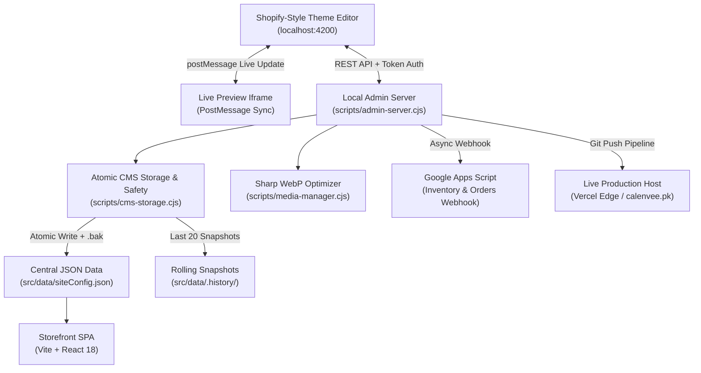

# Calenvee.pk — CMS Architecture & Technical Manual

> **Production Platform**: Vite + React 18 SPA (Vercel Edge)  
> **CMS Core**: Schema-Driven JSON Data Model (`src/schema/`, `src/data/siteConfig.json`)  
> **Local Theme Customizer**: Shopify-Style Theme Editor (`http://localhost:4200`, `scripts/admin-server.cjs`)  
> **Cloud Automations**: Google Apps Script + Google Sheets Webhook  
> **Branch**: `feat/functional-cms`

---

## 1. System Overview & Architectural Topology

Calenvee.pk is engineered as a zero-latency, high-conversion e-commerce storefront paired with an autonomous local administration engine. The architecture completely eliminates third-party monthly SaaS subscription costs while giving the store owner 100% control over every section, heading, banner, card, pricing rule, and media asset.



---

## 2. Complete Schema Reference (`src/schema/`)

All storefront content, layout structures, and administration forms are derived from one unified type system defined in [src/schema/](file:///c:/Users/Alsaba/Documents/Calenvee/src/schema).

### 2.1 Universal Section Schema (`SectionSchema`)

Every section rendered across any page inherits this strict structure:

| Field | Type | Description |
|---|---|---|
| `id` | `string` | Unique identifier (e.g. `home-hero`, `shop-grid-trending`). |
| `type` | `SectionTypeEnum` | One of 12 registered section types. |
| `visible` | `boolean` | Immediate visibility toggle. When `false`, section is completely removed from DOM. |
| `showFrom` | `string (optional)` | ISO 8601 datetime with PKT offset (`+05:00`). Hidden before this time. |
| `showUntil` | `string (optional)` | ISO 8601 datetime with PKT offset (`+05:00`). Auto-hides after this time. |
| `settings` | `Record<string, any>` | Schema-validated configuration parameters specific to the section type. |
| `blocks` | `BlockSchema[]` | Nested sub-items (e.g. hero slides, banner cards, trust badges, FAQ items). |

### 2.2 The 12 Registered Section Types

| Type Identifier | Component | Primary Settings & Blocks |
|---|---|---|
| `hero` | [`HeroSection`](file:///c:/Users/Alsaba/Documents/Calenvee/src/components/sections/HeroSection.tsx) | `autoIntervalSeconds`, `slides[]` (image, mandatory alt text, kicker, headline prefix, highlight, subtitle, CTA text/link). |
| `product-grid` | [`ProductGridSection`](file:///c:/Users/Alsaba/Documents/Calenvee/src/components/sections/ProductGridSection.tsx) | `title`, `subtitle`, `rule` (`bestsellers`, `trending`, `new-drops`, `category`, `manual`), `limit`, `columnsDesktop` (2-5), `columnsMobile` (1-2). |
| `category-grid` | [`CategoryGridSection`](file:///c:/Users/Alsaba/Documents/Calenvee/src/components/sections/CategoryGridSection.tsx) | `title`, `subtitle`, `columns` (2-4), `limit`, `viewAllLink`. |
| `deal-of-the-day` | [`DiscountOfferBanner`](file:///c:/Users/Alsaba/Documents/Calenvee/src/components/home/DiscountOfferBanner.tsx) | `dealId`, `title`, `subtitle`, `ctaText`, `autoHideWhenExpired` (`boolean`). |
| `promo-banner` | [`PromoBannerSection`](file:///c:/Users/Alsaba/Documents/Calenvee/src/components/sections/PromoBannerSection.tsx) | `layout` (`single`, `split-2`, `trio-3`), `banners[]` (badge, title, subtitle, CTA link, image, alt text). |
| `trust-badges` | [`TrustBadgesSection`](file:///c:/Users/Alsaba/Documents/Calenvee/src/components/sections/TrustBadgesSection.tsx) | `title`, `subtitle`, `badges[]` (`id`, `title`, `subtitle`, `icon`). |
| `testimonials` | [`ReviewsMarquee`](file:///c:/Users/Alsaba/Documents/Calenvee/src/components/home/ReviewsMarquee.tsx) | `title`, `subtitle`, `layout` (`marquee`, `grid`), `limit`. |
| `brand-story` | [`BrandStorySection`](file:///c:/Users/Alsaba/Documents/Calenvee/src/components/sections/BrandStorySection.tsx) | `badge`, `title`, `paragraphs[]`, `stats[]` (`value`, `label`), `image`. |
| `faq` | [`FaqSection`](file:///c:/Users/Alsaba/Documents/Calenvee/src/components/sections/FaqSection.tsx) | `title`, `subtitle`, `items[]` (`question`, `answer`). |
| `newsletter` | [`NewsletterBanner`](file:///c:/Users/Alsaba/Documents/Calenvee/src/components/home/NewsletterBanner.tsx) | `title`, `subtitle`, `buttonText`, `discountPromoCode`. |
| `rich-text` | [`RichTextSection`](file:///c:/Users/Alsaba/Documents/Calenvee/src/components/sections/RichTextSection.tsx) | `title`, `contentHtml` (sanitized with DOMPurify), `maxWidth`, `alignment`. |
| `image-gallery` | [`ImageGallerySection`](file:///c:/Users/Alsaba/Documents/Calenvee/src/components/sections/ImageGallerySection.tsx) | `title`, `columns` (2-6), `images[]` (`url`, mandatory `alt`). |

### 2.3 Global Store Configuration Schema (`GlobalConfigSchema`)

Controls brand-wide settings applied across every page, header, and footer:
- **`announcementBar`**: `enabled` toggle, `messages[]`, rotation `speed` (ms).
- **`themeTokens`**: `brandNavy` (`#0B132B`), `brandOrange` (`#F97316`), typography.
- **`shipping`**: Single source of truth: `standardShippingFee` (Rs. 250), `freeShippingThreshold` (Rs. 3,500), delivery window (7-10 working days).
- **`payments`**: Enable/disable toggles & account credentials for COD, JazzCash, EasyPaisa, and Meezan Bank / Raast Instant.
- **`contact`**: Store name, WhatsApp raw and display numbers, support email, physical city/country.
- **`cardSettings`**: Global card display toggles: `showBadge`, `showRating`, `showCompareAtPrice`, `showQuickAdd`, `showWishlist`.
- **`header`**: Logo text, logo image, favicon, and dynamic navigation menu items.
- **`footer`**: Multi-column links hierarchy, payment icon badges, and copyright string.

---

## 3. Section Development Guide

### How to Create a New Section Component

1. **Define Schema Settings**:
   In [src/schema/sections.ts](file:///c:/Users/Alsaba/Documents/Calenvee/src/schema/sections.ts), create the zod settings schema:
   ```ts
   export const MyNewSectionSettingsSchema = z.object({
     headline: z.string().default('New Section Headline'),
     accentColor: z.string().default('#F97316'),
   });
   ```
2. **Implement React Component**:
   In [src/components/sections/](file:///c:/Users/Alsaba/Documents/Calenvee/src/components/sections), create `MyNewSection.tsx`:
   ```tsx
   import React from 'react';
   import { SectionConfig } from '../../schema';

   export const MyNewSection: React.FC<{ section: SectionConfig }> = ({ section }) => {
     const { headline, accentColor } = section.settings;
     return (
       <section className="py-12 bg-white">
         <h2 style={{ color: accentColor }} className="text-2xl font-bold">{headline}</h2>
       </section>
     );
   };
   ```
3. **Register in Section Registry**:
   In [src/components/sections/SectionRenderer.tsx](file:///c:/Users/Alsaba/Documents/Calenvee/src/components/sections/SectionRenderer.tsx), add the case to the switch statement:
   ```tsx
   case 'my-new-section':
     return <MyNewSection section={section} />;
   ```
4. **Register in Admin Section Library**:
   Add the item to `SECTION_LIBRARY_ITEMS` in [scripts/admin-ui.html](file:///c:/Users/Alsaba/Documents/Calenvee/scripts/admin-ui.html) so it appears in the store owner's "+ Add Section" modal.

---

## 4. Non-Technical Store Owner Manual

### 4.1 Launching the Administration Portal
Open PowerShell or Terminal and execute:
```bash
npm run admin
```
Then navigate to **`http://localhost:4200`** in Google Chrome or Microsoft Edge.

### 4.2 Theme Customizer Workflow
1. Click the **🎨 Theme & Page Customizer** tab in the top navigation.
2. Select the target page from the dropdown (e.g. *Home Page*, *Shop*, *Contact*, or *⚙️ Global Theme*).
3. **Show/Hide Sections**: Click the 👁️ Eye icon on any section card. The section instantly appears or vanishes in the live preview.
4. **Reorder Sections**: Click the ▲ Up or ▼ Down buttons on any section to re-position it on the page.
5. **Edit Content**: Click directly on any section card to open its settings drawer. Edit headlines, descriptions, button links, or pick images. All keystrokes reflect in the live preview iframe without page reload.
6. **Device Previews**: Click the Desktop (1440px), Tablet (768px), or Mobile (390px) icons in the toolbar to test responsive readability.
7. **Undo / Redo**: Made an accidental mistake? Press `Ctrl + Z` to undo or `Ctrl + Y` to redo.
8. **Publish**: Click the orange **Publish Storefront** button. Review the bulleted summary of all modified sections in the Diff Modal, then click **Confirm & Publish Live**.

### 4.3 Media Library & WebP Optimization
1. Switch to the **🖼️ Media Library** tab.
2. Click **Upload New Image**.
3. Choose your file and provide a **Mandatory Alt Text** (e.g. *Royal Gold Chronograph Watch*).
4. The system automatically converts the file to Google WebP format at 85% quality and generates a 400px mobile thumbnail.
5. Use the filter buttons (*All*, *In Use*, *Unused*, *Oversized*) to identify unused assets and optimize store performance.

### 4.4 Managing Products & Variants
1. Switch to the **📦 Products** tab.
2. Search products by title or filter by category.
3. Click **Edit ↗** to modify price, compare-at price, inventory stock units, multiple photos, badges (Bestseller / Trending / New Drop), and status (*Published*, *Hidden*, *Draft*, *Scheduled*).
4. Changes save atomically and synchronize in real-time with Google Sheets Inventory automations.

---

## 5. Deployment, Rollback & Server-Side Safety

### 5.1 Atomic Writes & Protection Against Corruption
In [scripts/cms-storage.cjs](file:///c:/Users/Alsaba/Documents/Calenvee/scripts/cms-storage.cjs):
- **Path Traversal Guard**: Every file write is validated via `isPathSafe()`. Writes attempting to escape outside `src/data/` or `public/` are immediately blocked with a `Security Exception`.
- **Automatic Backup**: Before any JSON file is overwritten, an automatic `.bak` copy of the previous state is created.
- **Isolated Temp Write & Atomic Rename**: The payload is written to a unique `.tmp.<timestamp>` file and flushed to disk before being renamed atomically via `fs.renameSync()`. If a power outage or disk failure occurs mid-write, the existing file remains 100% intact.

### 5.2 Rolling 20-Snapshot Version History
Every time the store owner publishes changes:
1. A permanent snapshot is archived in `src/data/.history/snapshot-<timestamp>.json` with timestamp, date string, and summary note.
2. Older snapshots beyond the last 20 are pruned automatically.
3. To restore any previous version, open the **History** modal in the Theme Customizer and click **Restore Version**. The previous configuration is atomically restored and drafted immediately.

### 5.3 Git Sync & Vercel Edge Pipeline
Clicking **Publish Live** in the Deploy tab executes:
1. `git add -A && git commit -m "Store content & catalog update..."`
2. `git push origin feat/functional-cms`
3. Vercel automatically detects the push and deploys the new build to the global edge network across Pakistan in ~45 seconds.
