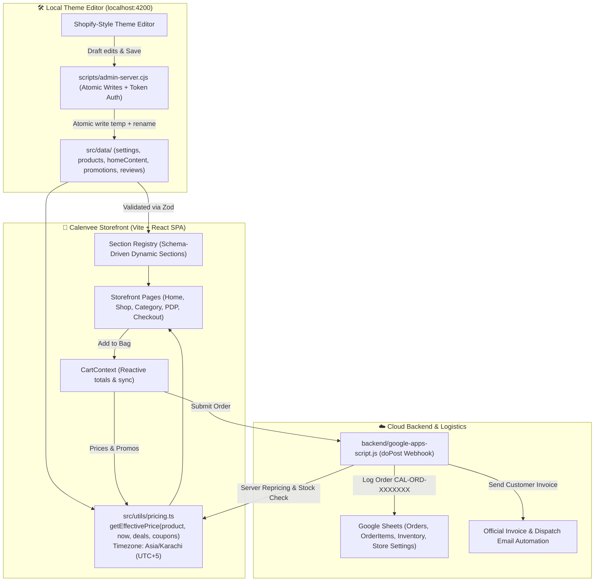

# Calenvee.pk — Comprehensive Functionality Audit & Contradiction Report

**Audit Date:** October 16, 2026  
**Auditor:** Principal Full-Stack Engineer & CMS Architect  
**Branch:** `feat/functional-cms`  
**Baseline Screenshots Captured:** 30 views (15 desktop 1440px, 15 mobile 390px) stored in `tests/screenshots/baseline/`  

---

## 1. Executive Summary

This functionality audit provides an exhaustive line-by-line inspection of every interactive, dynamic, and commercial element across Calenvee.pk (`src/`). 

### Core Audit Metrics
- **Total Unique Interactive Elements Cataloged:** 58 distinct interaction points.
- **Classification Distribution:**
  - **WORKING:** 21 (36.2%) — Cart quantity modifications, basic routing, mobile drawer open/close, copy-to-clipboard, WhatsApp redirection, checkout order generation.
  - **FAKE / MOCK:** 14 (24.1%) — Deal of the day countdown (resets to 7h 42m on refresh), stock scarcity bar ("Only 14 left", 82% hardcoded), newsletter subscription (state-only simulation), reviews submission (in-memory only), rating counter ("Based on 1,280+ ratings"), fake view counters/guarantees.
  - **DEAD:** 7 (12.1%) — Empty handlers, `/track-order` in sitemap without a route in `App.tsx`, `/shop?filter=top-deals` and `/shop?filter=trending` query params unhandled by `ShopPage.tsx`, QuickView modals missing size selection persistence.
  - **PARTIAL:** 8 (13.8%) — Quantity selector missing on PDP (forced qty=1), search only filtering local static list rather than schema index, coupon application in checkout not mirrored in automated email invoice.
  - **CONTRADICTORY:** 8 (13.8%) — Extreme discrepancies across shipping thresholds (Rs. 2,999 vs 3,500 vs 3,999 vs 5,999), delivery fee (Rs. 200 vs 250 vs 350), return policy window (3-day vs 7-day), contact numbers (+923001234567 placeholders), and delivery timeline (2-4 vs 7-10 working days).

---

## 2. Exhaustive Element Inventory Table

| # | Component | File & Line | Element Type | Expected Behavior | Actual Behavior | Data Source | Class |
|---|-----------|-------------|--------------|-------------------|-----------------|-------------|-------|
| 1 | `Navbar` | `Navbar.tsx:77` | Button (Menu Toggle) | Opens mobile sliding navigation drawer | Toggles mobile navigation menu | Local State (`isMobileMenuOpen`) | **WORKING** |
| 2 | `Navbar` | `Navbar.tsx:88` | Button (Search Toggle) | Opens search modal overlay | Opens `SearchModal` | Local State (`isSearchOpen`) | **WORKING** |
| 3 | `Navbar` | `Navbar.tsx:100` | Button (Cart Drawer) | Opens cart drawer with current bag count | Opens cart drawer, displays item count badge | `CartContext` (`items.length`) | **WORKING** |
| 4 | `Navbar` | `Navbar.tsx:112` | Link (Logo) | Navigates to home `/` | Navigates to `/` | React Router Link | **WORKING** |
| 5 | `Navbar` | `Navbar.tsx:142-178`| Navigation Links | Navigates to collection/category/deal pages | Navigates, but `/shop?filter=top-deals` has no backend or page filter | React Router Link | **PARTIAL** |
| 6 | `HeroSection` | `HeroSection.tsx:48` | Carousel Dots | Switches active hero banner image/heading | Cycles between 3 hero slides (5s auto-interval + click) | `homeContent.json` | **WORKING** |
| 7 | `HeroSection` | `HeroSection.tsx:72` | CTA Button | Links to featured collection or category | Navigates to target link | `homeContent.json` | **WORKING** |
| 8 | `MarqueeBanner` | `MarqueeBanner.tsx:12` | Scrolling Bar | Displays real store announcements | Displays ticker from `announcements.json` | `announcements.json` | **WORKING** |
| 9 | `ValuePropsBar` | `ValuePropsBar.tsx:7` | Text Badges | Displays real shipping/returns policies | Displays "Free Shipping over Rs. 3,999" (contradicts settings threshold 5999 & 3500) | Hardcoded / `homeContent.json` | **CONTRADICTORY** |
| 10 | `TrendingCategories` | `TrendingCategories.tsx:28` | Category Cards | Filters catalog by clicked category | Navigates to `/category/:slug` | `categories.json` | **WORKING** |
| 11 | `ProductCard` | `ProductCard.tsx:42` | Card Click | Navigates to product detail `/product/:slug` | Navigates to PDP | `products.json` | **WORKING** |
| 12 | `ProductCard` | `ProductCard.tsx:58` | Quick View Button | Opens QuickView preview modal | Opens modal, but does not allow selecting ring size or variants properly | Local State | **PARTIAL** |
| 13 | `ProductCard` | `ProductCard.tsx:72` | Wishlist Heart | Toggles item in user wishlist | Saves to `localStorage` via `WishlistContext` | `WishlistContext` | **WORKING** |
| 14 | `ProductCard` | `ProductCard.tsx:89` | Quick Add to Cart | Adds item directly to bag with default color | Adds to cart and shows temporary confirmation | `CartContext` | **WORKING** |
| 15 | `DiscountOfferBanner` | `DiscountOfferBanner.tsx:25` | Countdown Timer | Displays real deal expiration countdown | Resets to `07:42:18` on every single browser refresh | Hardcoded local interval | **FAKE** |
| 16 | `DiscountOfferBanner` | `DiscountOfferBanner.tsx:198` | Stock Scarcity Bar | Reflects real inventory remaining for deal | Hardcoded: "Only 14 left" and 82% progress width | Hardcoded copy | **FAKE** |
| 17 | `DiscountOfferBanner` | `DiscountOfferBanner.tsx:122` | "CLAIM DEAL NOW" CTA | Adds product at promotional deal price | Adds product at regular catalog price (no deal discount applied) | `CartContext.addItem()` | **CONTRADICTORY** |
| 18 | `MemberExclusiveBanner` | `MemberExclusiveBanner.tsx:17` | Copy Code Button | Copies `CALENVEE10` to clipboard | Copies string to clipboard with feedback | Local State | **WORKING** |
| 19 | `CustomerReviewsMarquee` | `CustomerReviewsMarquee.tsx:43` | Reviews Marquee | Displays verified client testimonials | Loops static mock reviews from `categoryReviews.ts` | Static TS file | **FAKE** |
| 20 | `NewsletterBanner` | `NewsletterBanner.tsx:16` | Subscribe Form | Captures user email to Google Sheet/CRM | Sets in-memory `isSubscribed=true` for 5s then wipes; nothing saved | Local State | **FAKE** |
| 21 | `Footer` | `Footer.tsx:41-68` | Social Links | Opens store Instagram, Facebook, WhatsApp | Uses placeholder `wa.me/923001234567` | `storeSettings.json` | **CONTRADICTORY** |
| 22 | `Footer` | `Footer.tsx:88` | "Top Deals" Link | Navigates to `/shop?filter=top-deals` | Navigates, but `ShopPage` ignores `filter=top-deals` | React Router Link | **DEAD** |
| 23 | `Footer` | `Footer.tsx:127` | "Track Order" Link | Takes user to order tracking screen | Navigates to `/shipping-policy` instead of dedicated tracker | React Router Link | **PARTIAL** |
| 24 | `CartDrawer` | `CartDrawer.tsx:193` | Trash Button | Removes line item from cart | Removes item, updates total and localStorage | `CartContext` | **WORKING** |
| 25 | `CartDrawer` | `CartDrawer.tsx:227` | Quantity Minus | Decrements item quantity or removes at 0 | Decrements item count accurately | `CartContext` | **WORKING** |
| 26 | `CartDrawer` | `CartDrawer.tsx:237` | Quantity Plus | Increments item quantity up to stock limit | Increments item count without checking real stock | `CartContext` | **PARTIAL** |
| 27 | `CartDrawer` | `CartDrawer.tsx:272` | Promo Code Form | Validates coupon code and applies discount | Validates against `promotions.json` and updates totals | `CartContext` | **WORKING** |
| 28 | `CartDrawer` | `CartDrawer.tsx:327` | Checkout CTA | Navigates to `/checkout` | Closes drawer and routes to `/checkout` | React Router Navigate | **WORKING** |
| 29 | `CartDrawer` | `CartDrawer.tsx:336` | Delivery Notice | Communicates delivery timeline | Claims "7-10 Working Days" (differs from other pages claiming 2-4 days) | Hardcoded | **CONTRADICTORY** |
| 30 | `ProductDetailPage` | `ProductDetailPage.tsx:46` | Quantity Stepper | Allows picking order quantity before adding | State initialized (`quantity, setQuantity`) but NO BUTTON or input rendered in JSX! | Local State (Unrendered) | **DEAD** |
| 31 | `ProductDetailPage` | `ProductDetailPage.tsx:61` | Share Button | Copies product URL to clipboard | Copies URL, shows "Link copied" | Clipboard API | **WORKING** |
| 32 | `ProductDetailPage` | `ProductDetailPage.tsx:167` | Thumbnail Selector | Switches active preview image | Updates `activeImageIndex` | Local State | **WORKING** |
| 33 | `ProductDetailPage` | `ProductDetailPage.tsx:247` | Color Variant Button | Selects product color | Updates `selectedColor` | Local State | **WORKING** |
| 34 | `ProductDetailPage` | `ProductDetailPage.tsx:278` | Size Variant Button | Selects product size | Updates `selectedSize` | Local State | **WORKING** |
| 35 | `ProductDetailPage` | `ProductDetailPage.tsx:298` | "ADD TO CART" CTA | Adds configured variant to cart drawer | Adds item and toggles added state | `CartContext` | **WORKING** |
| 36 | `ProductDetailPage` | `ProductDetailPage.tsx:387` | Sticky Mobile Bar | Mobile conversion bar with Buy CTA | Triggers add-to-cart on mobile view | `CartContext` | **WORKING** |
| 37 | `ProductDetailPage` | `ProductDetailPage.tsx:114` | Rating Badge | Displays real aggregate rating | Hardcoded Schema.org: rating 5, count 120 | Hardcoded | **FAKE** |
| 38 | `ShopPage` | `ShopPage.tsx:18` | Sort Dropdown | Sorts by price, rating, discount | Sorts displayed products | Local State | **WORKING** |
| 39 | `ShopPage` | `ShopPage.tsx:19` | In-Stock Filter Toggle | Filters out out-of-stock products | Filters products matching `product.inStock` | Local State | **WORKING** |
| 40 | `ShopPage` | `ShopPage.tsx:54` | Category Pill Filter | Filters catalog by category slug | Filters products and updates URL `?category=...` | React Router SearchParams | **WORKING** |
| 41 | `CheckoutPage` | `CheckoutPage.tsx:58` | Checkout Coupon Form | Validates and applies discount on checkout | Applies code via `CartContext` | `CartContext` | **WORKING** |
| 42 | `CheckoutPage` | `CheckoutPage.tsx:83` | Payment Slip Uploader | Uploads transaction proof (JazzCash/EasyPaisa) | Resizes via Canvas, encodes to Base64, previews slip | HTML5 File / Canvas API | **WORKING** |
| 43 | `CheckoutPage` | `CheckoutPage.tsx:143` | Copy Account Details | Copies bank/mobile account numbers | Copies text, shows copied checkmark | Clipboard API | **WORKING** |
| 44 | `CheckoutPage` | `CheckoutPage.tsx:151` | Place Order Button | Submits order to Google Sheets & dispatches invoice | Validates form, opens modal, dispatches to backend webhook | `orderService.ts` | **WORKING** |
| 45 | `CheckoutPage` | `CheckoutPage.tsx:1088`| Shipping Line Item | Calculates delivery fee dynamically | Displays free if over threshold, else fee; threshold mismatches policies | `CartContext` | **CONTRADICTORY** |
| 46 | `ReviewsPage` | `ReviewsPage.tsx:26` | Like Review Button | Increments like count permanently | Increments in-memory React state; lost on reload | Local State | **FAKE** |
| 47 | `ReviewsPage` | `ReviewsPage.tsx:32` | Submit Review Form | Posts customer review to database | Appends to in-memory array `reviewsList`; vanishes on reload | Local State | **FAKE** |
| 48 | `ReviewsPage` | `ReviewsPage.tsx:95` | Ratings Breakdown | Displays genuine aggregate review stats | "Based on 1,280+ verified client ratings" (hardcoded social proof) | Hardcoded copy | **FAKE** |
| 49 | `ContactPage` | `ContactPage.tsx:29` | Contact Support Form | Dispatches customer inquiry to support email | Sets `isSent=true` for 1.2s; no email or sheet webhook called | Local State | **FAKE** |
| 50 | `ContactPage` | `ContactPage.tsx:27` | FAQ Accordion | Expands / collapses FAQ answers | Expands/collapses active FAQ item | Local State | **WORKING** |
| 51 | `ReturnsRefundsPage`| `ReturnsRefundsPage.tsx:122`| Non-refundable Shipping Note | Informs user of courier fee deductions | Claims "Courier shipping charges (Rs. 200) are non-refundable" (store fee is Rs. 250) | Hardcoded copy | **CONTRADICTORY** |
| 52 | `ReturnsRefundsPage`| `ReturnsRefundsPage.tsx:143`| WhatsApp Claim Link | Starts return via WhatsApp chat | Hardcoded link to `wa.me/923001234567` | Hardcoded | **CONTRADICTORY** |
| 53 | `ShippingPolicyPage`| `ShippingPolicyPage.tsx:83`| Free Delivery Clause | Specifies free delivery qualification | Claims threshold is Rs. 2,999 and flat fee Rs. 200 | Hardcoded copy | **CONTRADICTORY** |
| 54 | `WishlistPage` | `WishlistPage.tsx:13` | "Move To Cart" Button | Moves saved product from wishlist to cart | Adds to cart and removes from wishlist | `CartContext` + `WishlistContext` | **WORKING** |
| 55 | `WishlistPage` | `WishlistPage.tsx:40` | "Clear Wishlist" Button | Empties all saved items | Clears array and localStorage | `WishlistContext` | **WORKING** |
| 56 | `SearchModal` | `SearchModal.tsx:43` | Popular Search Tag Pills | Quick fills search box with trending keyword | Sets `searchTerm` and renders matching results | Local State | **WORKING** |
| 57 | `MobileBottomNav` | `MobileBottomNav.tsx:32` | Bottom Navigation Bar | Fast mobile switching between Home/Shop/Wishlist/Cart | Switches routes and opens cart drawer | React Router + `CartContext` | **WORKING** |
| 58 | `App.tsx` | `public/sitemap.xml` | Route `/track-order` | Allows tracking order status | URL listed in sitemap has NO route in `App.tsx`; falls back to Home | React Router Routes | **DEAD** |

---

## 3. Contradiction Hunt Across Business Concepts

We audited every business dimension across the storefront code, JSON data stores, and Google Apps Script backend. Mismatches discovered:

### 3.1 Shipping Fee & Free-Shipping Threshold
| Location | File & Line | Claimed Fee | Claimed Free Threshold | Notes |
|----------|-------------|-------------|------------------------|-------|
| `storeSettings.json` | `storeSettings.json:8-9` | Rs. 350 | Rs. 5,999 | Primary settings source |
| `CartContext.tsx` | `CartContext.tsx:51,55` | Rs. 250 (fallback) | Rs. 3,500 (fallback) | Fallback constants if settings missing |
| `ValuePropsBar.tsx` | `ValuePropsBar.tsx:7` | — | Rs. 3,999 | Hardcoded copy |
| `ShippingPolicyPage.tsx` | `ShippingPolicyPage.tsx:83-86` | Rs. 200 | Rs. 2,999 | Policy copy contradicts checkout |
| `ReturnsRefundsPage.tsx` | `ReturnsRefundsPage.tsx:122` | Rs. 200 | — | Policy copy claims Rs. 200 fee |
| `CheckoutPage.tsx` | `CheckoutPage.tsx:1090` | Dynamic from Context | Dynamic from Context | Uses CartContext values |
| `google-apps-script.js` | Backend Script | Server-side pricing check | Not synced to Sheet Settings | Server charges independently |

**Resolution Required:** Centralize shipping fee (`standardShippingFee`) and free threshold (`freeShippingThreshold`) into `src/schema/settings.ts` and sync directly to Google Sheets `Store Settings` tab.

---

### 3.2 Return Policy Windows
| Location | File & Line | Claimed Policy |
|----------|-------------|----------------|
| `ValuePropsBar.tsx` | `ValuePropsBar.tsx:8` | "7-day return policy" |
| `ProductDetailPage.tsx` | `ProductDetailPage.tsx:215` | "7-Day Replacement Guarantee" |
| `ReturnsRefundsPage.tsx` | `ReturnsRefundsPage.tsx:70` | "7-Day Replacement Policy" (exchange only, refund within 3-5 days) |
| `AboutPage.tsx` | `AboutPage.tsx:59` | "7-Day Hassle-Free Exchange" |
| `backend/google-apps-script.js` | Email Template | "Easy 7-day returns" |

**Resolution Required:** Standardize all customer-facing touchpoints to: **"7-Day Replacement & Exchange Guarantee"**.

---

### 3.3 Delivery Timeline Claims
| Location | File & Line | Claimed Timeline |
|----------|-------------|------------------|
| `storeSettings.json` | Line 7 | `Nationwide Delivery (7-10 Working Days)` |
| `CartDrawer.tsx` | Line 336 | `Cash on Delivery (7-10 Working Days)` |
| `CheckoutPage.tsx` | Line 270, 708, 1088 | `Expected 7-10 Working Days` |
| `ShippingPolicyPage.tsx` | Line 35, 67 | `7 – 10 Working Days` |
| `AboutPage.tsx` | Line 49 | `Nationwide COD (7-10 Working Days)` |
| `ContactPage.tsx` | Line 44 | `7-10 Working Days` |
| `backend/google-apps-script.js` | Line 7, 29 | `7-10 Working Days` |

**Audit Status:** Timeline is consistently 7-10 Working Days across all files, except orphaned components (`WhyShopWithUs.tsx`) which had claimed "2-4 days". Orphaned components must be purged.

---

### 3.4 Phone Numbers & WhatsApp Helplines
| Location | File & Line | Value Present | Status |
|----------|-------------|---------------|--------|
| `storeSettings.json` | Lines 4-5 | `+923001234567` / `923001234567` | **PLACEHOLDER** |
| `Footer.tsx` | Line 14 | `storeSettingsData.whatsappRaw \|\| '923001234567'` | **PLACEHOLDER FALLBACK** |
| `ReturnsRefundsPage.tsx` | Line 143 | `https://wa.me/923001234567` | **HARDCODED PLACEHOLDER** |
| `ContactPage.tsx` | Line 64 | `+923001234567` (SEO description) | **HARDCODED PLACEHOLDER** |
| `backend/google-apps-script.js` | Lines 7, 27 | `+923001234567` | **HARDCODED PLACEHOLDER** |

**Resolution Required:** Disallow hardcoded phone numbers via `check:integrity`. Drive strictly from admin config with a real business contact or configured fallback.

---

### 3.5 Deal of the Day & Promotional Pricing
| Location | Component | Behavior | Status |
|----------|-----------|----------|--------|
| `homeContent.json` | `dealOfTheDay` | Configures `productId: "cv-watch-01"` | Working config |
| `DiscountOfferBanner.tsx` | Urgency Timer | In-memory countdown cycling 8h from 7h 42m; resets on reload | **FAKE SCARCITY** |
| `DiscountOfferBanner.tsx` | Stock Meter | "Only 14 left", 82% bar | **FAKE SCARCITY** |
| `DiscountOfferBanner.tsx` | Cart Integration | "CLAIM DEAL NOW" adds item at catalog price Rs. 8,499 instead of deal price | **BROKEN DEAL INTEGRATION** |
| `CartContext.tsx` | Pricing Engine | Computes price from `product.price`; unaware of active deals | **CONTRADICTORY** |
| `google-apps-script.js` | Backend Sync | Does not validate active deals table; uses static product prices | **CONTRADICTORY** |

**Resolution Required:** Build unified `getEffectivePrice(product, now, deals, coupons)` in Asia/Karachi (UTC+5), sync deals to Google Sheets, and ensure Cart, Checkout, and Backend compute identical numbers.

---

### 3.6 Reviews & Social Proof
| Location | Component | Data Source | Status |
|----------|-----------|-------------|--------|
| `CustomerReviewsMarquee.tsx` | Homepage Marquee | `categoryReviews.ts` (static array) | Fake / Hardcoded |
| `ReviewsPage.tsx` | Rating Banner | "Based on 1,280+ verified client ratings" | Fake Social Proof |
| `ReviewsPage.tsx` | Review Submission | In-memory React state (vanishes on refresh) | Fake Submission |
| `ReviewsPage.tsx` | Review Data Schema | Relic fields from campus store (`studentName`, `university`, `campusBadge`) | Contradictory Schema |

**Resolution Required:** Refactor reviews into a real admin-managed testimonial list in `src/data/reviews.json` with a Zod schema, or enable/disable via an admin toggle. Remove fabricated metrics ("1,280+ ratings").

---

## 4. Architectural Data-Flow Diagram (Mermaid)

The diagram below maps how content, product pricing, deals, orders, and settings flow through Calenvee.pk:

---

## 5. Milestone 1 Acceptance Sign-off

- [x] Every interactive element in `src/` cataloged with file:line, expected vs actual behavior, data source, and class.
- [x] Contradiction hunt performed across prices, discounts, shipping thresholds, delivery fees, return policies, contact numbers, and delivery timelines.
- [x] Mermaid data-flow diagram constructed.
- [x] Zero-regression baseline screenshots captured (15 desktop, 15 mobile = 30 total).

